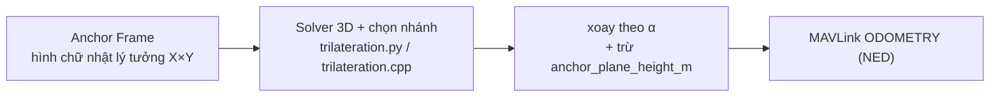

# Layout anchor UWB: ROS (SITL) ↔ ESP32 (phần cứng)

Tài liệu này là **phần chuyên sâu về layout anchor** của bài toán đối chiếu
ROS ↔ ESP32. Bản tổng quan các điểm khác biệt khác nằm ở
[`UWB_ROS_ESP32_COMPARISON.md`](UWB_ROS_ESP32_COMPARISON.md) — mục 1 ở đó chỉ
tóm tắt. Ở đây ta đi sâu vào **toạ độ, chiều trục, gốc toạ độ và cách hiệu
chỉnh**, vì đây là nguồn gốc của mọi lỗi vị trí.

> **Trạng thái: đã đồng bộ (2026-11).** Trước đây hai bên dùng **hai frame khác
> nhau** — ROS khai báo layout trong **ENU** của Gazebo, ESP32 khai báo trong
> **NED** — nên cùng một bộ anchor vật lý lại ra hai kết quả lệch 90°. Nay cả hai
> bên dùng **chung một Anchor Frame**, xoay bằng cùng một góc $\alpha$.

---

## 1. Ba khái niệm phải tách bạch

Rất nhiều lỗi vị trí đến từ việc lẫn 3 khái niệm này:

| Khái niệm | Ý nghĩa | Quyết định bởi |
| :-- | :-- | :-- |
| **Vị trí thực** (physical) | Toạ độ thật của anchor trong không gian, đo bằng thước | Con người, hiện trường |
| **Layout trong code** | Mảng số `ANCHOR_POS_LOCAL[]` / `AnchorLayout` | **Frame** mà code đó quy ước |
| **Frame** | Hệ toạ độ mà bộ số trên được hiểu | **Hợp đồng giữa code và ArduPilot** |

Bộ số trong code **không mang thông tin frame**. Nó chỉ có nghĩa khi đi kèm
quy ước frame của chính code đó. Đây là lý do hai bên "cùng số 5×5 m" vẫn
cho ra vị trí khác nhau.

---

## 2. Hợp đồng chung: Anchor Frame

### 2.1 Định nghĩa

**Anchor Frame** là hệ toạ độ mà solver trilateration làm việc:

```
a0 = (0, 0, 0)        a1 = (X, 0, 0)      X = 10 m (mặc định)
a3 = (0, Y, 0)        a2 = (X, Y, 0)      Y = 10 m (mặc định)
```

* `x` hướng về `a1`, `y` hướng về `a3`
* `z` hướng **xuống** — mặt phẳng anchor là mặt phẳng `z = 0`, nên tag **dưới**
  mặt phẳng có `z` **dương**
* Tâm của hình chữ nhật là `(X/2, Y/2)`

> **Layout không bắt buộc là hình vuông.** Ở hiện trường anchor được lắp ở
> chỗ có chỗ, nên cạnh `a0 → a1` và cạnh `a0 → a3` thường **không bằng nhau**.
> Vì vậy layout được mô tả bằng **hai** số `X` và `Y`, và cả hai bên (ROS và
> ESP32) đều lấy chúng từ cùng một cặp hằng số cấu hình.

Sơ đồ Anchor Frame (nhìn từ trên xuống):

```
        ↑ +x (hướng a0 → a1)
   a3 (0,Y) ●─────────────● a2 (X,Y)
            │             │
            │   a0 ●─────┘
            │     (0,0)
```

### 2.2 Vì sao solver luôn dùng hình chữ nhật lý tưởng

Khoảng cách đo được **bất biến** dưới phép xoay quanh trục đứng. Nên dù layout
vật lý có lệch bao nhiêu so với Bắc/Đông, solver vẫn có thể giải trên hình
chữ nhật lý tưởng, rồi **xoay kết quả** trước khi gửi đi.

Nhờ vậy hai bên hành xử **giống hệt nhau**, và mảng anchor trong code luôn ở
dạng "hình chữ nhật vuông góc" khớp với bản vẽ CAD.

> ### ⚠️ Đừng nhầm "vuông" với "hình vuông"
>
> Ở đây "vuông góc" nghĩa là **trục x ⊥ trục y**, không phải **4 cạnh bằng nhau**.
> `X` và `Y` là hai số độc lập.

### 2.3 Góc lệch α

Layout vật lý là cùng hình vuông đó, **xoay** một góc $\alpha$ so với
North/East — vì anchor được lắp ở chỗ có chỗ, chứ không nhất thiết theo hướng
Bắc/Đông.

**Định nghĩa (thống nhất cả hai bên):**

> $\alpha$ là **hướng (bearing) của `a0 → a1`, đo từ hướng Bắc, tính theo chiều
> kim đồng hồ nhìn từ trên xuống**.

| Tình huống thực tế | $\alpha$ |
| :-- | :-- |
| `a0 → a1` chĩa đúng hướng Bắc | `0°` |
| `a0 → a1` chĩa lệch về phía Đông | **dương** |
| `a0 → a1` chĩa lệch về phía Tây | **âm** |

Công thức xoay (giống hệt nhau hai bên):

```
N = x·cos(α) − y·sin(α)
E = x·sin(α) + y·cos(α)
D = z − anchor_plane_height_m
```

> ### ⚠️ Dấu của α
>
> "Cạnh `a0–a3` lệch hướng Đông α, cạnh `a0–a1` lệch hướng Bắc α" là **cùng
> một phép xoay**, mô tả bằng 2 cạnh khác nhau — không phải 2 ràng buộc độc lập.
>
> Thực tế chỉ có **1 con số** cần xác định: **bearing của hướng `a0 → a1` đo từ
> Bắc**. Đó chính là `config_yaw_offset_deg` (ESP32) và `alpha_deg` (ROS).
>
> Đảo dấu α ⇒ sai số vài mét (3.7 m ở α = 15°, 7.2 m ở α = 30°) — gấp hàng
> trăm lần `position_std_m = 0.05`.

### 2.4 Trục z và chiều cao mặt phẳng anchor

`z` trong Anchor Frame là **chiều sâu dưới mặt phẳng anchor**. Mặt phẳng anchor
nằm cao `anchor_plane_height_m` (mặc định 2 m) so với mặt đất, còn vị trí gửi
đi trong `ODOMETRY` là **tương đối với EKF Origin** (mặt đất). Vì vậy:

```
D = z − anchor_plane_height_m
```

Với mặt phẳng cao 2 m và tag ở 1 m dưới mặt phẳng: `D = 1 − 2 = −1`, tức tag
cao hơn mặt đất 1 m. ✔

### 2.5 Pipeline hai bên (đã đồng bộ)



| Bước | ROS | ESP32 |
| :-- | :-- | :-- |
| Layout | `uwb_layout.py` → `AnchorLayout` (`size_x_m`, `size_y_m`) | `tag_config.cpp` → `ANCHOR_POS_LOCAL[]` (mặc định từ `uwb_config.h`) |
| Xoay α | `AnchorLayout.rotate_to_ned()` | `convertLocalToNed()` (dùng `config_yaw_offset_deg`) |
| Dịch z | `AnchorLayout.to_ned_3d()` | `convertLocalToNed()` (trừ `config_anchor_plane_height_m`) |

---

## 3. Layout cụ thể của ROS (đang chạy, đã verify)

### 3.1 Toạ độ tuyệt đối trong world Gazebo (ENU, mét)

File `src/uwb_gz_plugin/worlds/uwb_runway.sdf` là **template**; vị trí anchor
được **sinh lại** theo layout mỗi lần launch
(`uwb_pozyx_bridge/uwb_world.py::render_world`):

```
      <anchor name="uwb_anchor0"><pos>0 0 2.0</pos></anchor>
      <anchor name="uwb_anchor1"><pos>0 10 2.0</pos></anchor>
      <anchor name="uwb_anchor2"><pos>10 10 2.0</pos></anchor>
      <anchor name="uwb_anchor3"><pos>10 0 2.0</pos></anchor>
```

Vuông **10 × 10 m** trên mặt phẳng `z = 2.0 m`. ID 0..3 gán theo thứ tự khai
báo trong SDF (`a.id = static_cast<int>(anchors_.size())`).

Với $\alpha = 0$ (mặc định), Anchor Frame trùng NED ⇒ world ENU của anchor là
`(E, N, U) = (0,0,2) (0,10,2) (10,10,2) (10,0,2)` — tức **thứ tự ID đi vòng
ngược chiều kim đồng hồ** khi nhìn từ trên xuống.

Khi layout là hình chữ nhật (ví dụ `X = 14 m`, `Y = 7 m`), world ENU trở thành
`(0,0,2) (0,14,2) (7,14,2) (7,0,2)` — vẫn giữ nguyên thứ tự ID.

### 3.2 Nguồn sự thật duy nhất

`src/uwb_pozyx_bridge/uwb_pozyx_bridge/uwb_layout.py`:

```python
ANCHOR_COUNT = 4
LAYOUT_SIZE_X_M = 10.0
LAYOUT_SIZE_Y_M = 10.0
ANCHOR_PLANE_HEIGHT_M = 2.0

@dataclass(frozen=True)
class AnchorLayout:
    size_x_m: float = LAYOUT_SIZE_X_M
    size_y_m: float = LAYOUT_SIZE_Y_M
    alpha_deg: float = 0.0
    plane_height_m: float = ANCHOR_PLANE_HEIGHT_M
    origin_north_m: float = 0.0
    origin_east_m: float = 0.0
```

Các hàm chính:

| Hàm | Việc |
| :-- | :-- |
| `anchor_frame_positions()` | Hình chữ nhật lý tưởng cho solver |
| `anchor_ned_positions()` | Anchor trong NED, tương đối `a0` |
| `anchor_world_enu()` | Anchor trong world Gazebo (ENU) |
| `rotate_to_ned(x, y)` | Xoay ngang theo α |
| `to_ned(x, y)` | Xoay + cộng offset gốc EKF |
| `to_ned_3d(x, y, z)` | Thêm dịch z theo chiều cao mặt phẳng anchor |
| `centre_enu()` | Tâm hình chữ nhật, trong world Gazebo |
| `random_spawn_enu(rng, margin_m)` | Điểm spawn ngẫu nhiên **trong** hình chữ nhật |

### 3.3 Tham số layout

| Tham số launch | Tham số node | Mặc định | Ý nghĩa |
| :-- | :-- | :-- | :-- |
| `layout_size_x_m` | `layout_size_x_m` | `10.0` | Cạnh `a0 → a1` (Anchor Frame), mét |
| `layout_size_y_m` | `layout_size_y_m` | `10.0` | Cạnh `a0 → a3` (Anchor Frame), mét |
| `layout_alpha_deg` | `layout_alpha_deg` | `0.0` | Bearing của `a0 → a1` đo từ Bắc, độ |
| — | `anchor_plane_height_m` | `2.0` | Cao của mặt phẳng anchor so với mặt đất, mét |

Launch file sinh lại world SDF từ layout rồi truyền `world` xuống
`x500_runway.launch.py`; node nhận cùng bộ tham số đó ⇒ plugin, model anchor
hiển thị, solver và vị trí spawn **luôn khớp nhau**.

### 3.4 Spawn ngẫu nhiên

Launch file nhận hai tham số:

| Tham số | Mặc định | Ý nghĩa |
| :-- | :-- | :-- |
| `random_spawn` | `true` | Bật/tắt spawn ngẫu nhiên |
| `spawn_seed` | — | Hạt giống RNG (để lặp lại được) |

Điểm spawn được rút **đều trong Anchor Frame** rồi mới xoay theo α ⇒ phân bố
đều trong hình chữ nhật bất kể layout có xoay hay không. Lề `margin_m = 1.5 m`
giữ drone khỏi sát anchor (vùng hình học đo kém). Với `random_spawn=false`,
drone spawn tại tâm hình chữ nhật (`centre_enu()`).

### 3.4 Gốc toạ độ của ROS

| Khái niệm | Vị trí |
| :-- | :-- |
| Gốc UWB (Anchor Frame `a0`) | **Góc** vuông `(0,0)` của world |
| Gốc EKF của ArduPilot (`SET_GPS_GLOBAL_ORIGIN`) | Cùng vị trí, mã hoá thành lat/lon từ `<spherical_coordinates>` của world |

```56:59:src/uwb_pozyx_bridge/launch/x500_uwb_runway.launch.py
ORIGIN_LATITUDE_DEG = -35.363262
ORIGIN_LONGITUDE_DEG = 149.165237
ORIGIN_ALTITUDE_M = 584.0
```

⇒ Khi drone ở đúng `a0`, `ODOMETRY` báo `(N, E, D) = (0, 0, −h)`.

---

## 4. Layout cụ thể của ESP32

### 4.1 Mảng mặc định trong code

Mặc định được dựng từ **hai** hằng số trong
`firmware/ESP32-DWM3000-UWB/UWB_RTLS_Tag/src/uwb_config.h`:

```c
#define CFG_DEFAULT_LAYOUT_SIZE_X_M 10.0f   // cạnh a0 → a1
#define CFG_DEFAULT_LAYOUT_SIZE_Y_M 10.0f   // cạnh a0 → a3
#define CFG_DEFAULT_YAW_OFFSET_DEG     0.0f
#define CFG_DEFAULT_ANCHOR_PLANE_HEIGHT_M 2.0f
```

và được đưa vào mảng runtime trong `tag_config.cpp`:

```cpp
const float CFG_DEFAULT_ANCHOR_POS[CFG_NUM_ANCHORS][3] = {
    {0.0f,                        0.0f, 0.0f},   // a0
    {CFG_DEFAULT_LAYOUT_SIZE_X_M, 0.0f, 0.0f},   // a1
    {CFG_DEFAULT_LAYOUT_SIZE_X_M, CFG_DEFAULT_LAYOUT_SIZE_Y_M, 0.0f},  // a2
    {0.0f, CFG_DEFAULT_LAYOUT_SIZE_Y_M, 0.0f},   // a3
};
```

⇒ **Trùng khớp chính xác** với Anchor Frame của ROS.

### 4.2 Mapping index ↔ anchor ID

```48:48:firmware/ESP32-DWM3000-UWB/UWB_RTLS_Tag/src/main.cpp
const uint8_t ANCHOR_IDS[NUM_ANCHORS] = {1, 2, 3, 4};
```

| index mảng | Anchor ID | Board flash | Vị trí Anchor Frame |
| :-- | :-- | :-- | :-- |
| 0 | 1 | `pio run -e anchor1` | `a0 = (0,0)` |
| 1 | 2 | `pio run -e anchor2` | `a1 = (X,0)` |
| 2 | 3 | `pio run -e anchor3` | `a2 = (X,Y)` |
| 3 | 4 | `pio run -e anchor4` | `a3 = (0,Y)` |

> **Khác biệt ID so với ROS:** ROS dùng **id 0..3**, ESP32 dùng **id 1..4**.
> Khi chuyển đổi layout, phải trừ 1. Xem §5.4.

### 4.3 Lệnh cấu hình qua Serial

```
cfg,x1,y1,z1,x2,y2,z2,x3,y3,z3,x4,y4,z4,yaw[,plane_height]
```

Ví dụ cho layout 10×10 m đồng phẳng, xoay 20° so với Bắc, mặt phẳng cao 2 m:

```
cfg,0,0,0,10,0,0,10,10,0,0,10,0,20,2
```

Đây là 12 toạ độ + yaw = 13 giá trị (bắt buộc), `plane_height` là giá trị thứ 14
(tùy chọn, mặc định 2.0).

Ví dụ cho layout **hình chữ nhật** 14 m × 7 m, xoay 20°:

```
cfg,0,0,0,14,0,0,14,7,0,0,7,0,20,2
```

> Lệnh serial nhận **toạ độ tuyệt đối** của từng anchor, nên nó đã hỗ trợ
> layout chữ nhật sẵn. Hằng số `CFG_DEFAULT_LAYOUT_SIZE_X_M` /
> `CFG_DEFAULT_LAYOUT_SIZE_Y_M` chỉ là **giá trị mặc định** khi tag khởi động
> mà không có lệnh `cfg` nào.

### 4.4 Kiểm chứng bằng phép thế chéo

Bạn đặt câu hỏi: *"đứng ở anchor0 nhìn về anchor3 thì anchor1 ở bên tay trái,
anchor2 ở góc còn lại (góc xa so với anchor0)"*. Với layout 10×10:

```
a0(0,0,0)  a1(10,0,0)  a2(10,10,0)  a3(0,10,0)
```

Đọc layout như NED (`x = North`, `y = East`):

```
  ESP32: dung a0->a3 = huong 90 (Dong)
     a1: huong tu a0 =   0.0 deg, TRAI so voi huong nhin, dist a0->a1 = 10.00 m
     a2: huong tu a0 =  45.0 deg, TRAI so voi huong nhin, dist a0->a2 = 14.14 m
```

Đối chiếu:

- Đứng ở `a0`, nhìn về `a3` ⇒ hướng **Đông** (bearing 90°). ✅
- `a1` nằm ở hướng **Bắc** (bearing 0°) từ `a0` ⇒ lệch **90° sang TRÁI**. ✅
- `a2` nằm ở hướng **Đông-Bắc** (bearing 45°) ⇒ lệch 45° sang trái, và là
  góc **xa nhất** (14.14 m = 10√2). ✅

⇒ **Layout 10×10 khớp chính xác với mô tả.**

### 4.5 Gốc toạ độ: góc hay tâm?

| | ROS | ESP32 |
| :-- | :-- | :-- |
| Gốc Anchor Frame | `a0` (góc) | `a0` (góc) |
| Khi drone ở giữa vuông | `(N,E) = (5, 5)` | `(N,E) = (5, 5)` |
| Khi drone ở góc `a0` | `(N,E) = (0, 0)` | `(N,E) = (0, 0)` |

⇒ **Hai bên dùng cùng một gốc.** `SET_GPS_GLOBAL_ORIGIN` + `DO_SET_HOME` của
ESP32 phải trỏ đúng `a0` thì mới khớp vị trí thực tế.

---

## 5. Bảng chuyển đổi layout ROS ↔ ESP32

### 5.1 Cùng một hình học, hai cách diễn đạt

Với cạnh `X` (a0→a1), cạnh `Y` (a0→a3) và mặt phẳng cao `h` so với mặt đất:

**ROS** (Anchor Frame):

```python
(0, 0, 0), (X, 0, 0), (X, Y, 0), (0, Y, 0)   # z = 0 nghĩa là nằm trên mặt phẳng anchor
```

**ESP32** (Anchor Frame):

```cpp
ANCHOR_POS_LOCAL[0] = { 0.0f, 0.0f, 0.0f};   // a0
ANCHOR_POS_LOCAL[1] = {   X, 0.0f, 0.0f};   // a1
ANCHOR_POS_LOCAL[2] = {   X,   Y, 0.0f};   // a2
ANCHOR_POS_LOCAL[3] = {0.0f,   Y, 0.0f};   // a3
```

⇒ **Hai bên giờ dùng *cùng một bộ số*.** Đây là điểm mấu chốt của việc đồng bộ.

### 5.2 Quy tắc chuyển đổi tổng quát (Anchor Frame ↔ NED ↔ ENU)

```
N = x·cos(α) − y·sin(α)
E = x·sin(α) + y·cos(α)
D = z − h            (h = anchor_plane_height_m)

(để render trong Gazebo)
E_enu = E,  N_enu = N,  U_enu = h − z
```

### 5.3 Ví dụ: layout với α = 20°

Anchor Frame: `a0(0,0)`, `a1(10,0)`, `a2(10,10)`, `a3(0,10)`.

| Anchor | Anchor Frame | NED (α = 20°) | Gazebo ENU (α = 20°) |
| :-- | :-- | :-- | :-- |
| `a0` | (0, 0) | (0.00, 0.00) | (0.00, 0.00, 2.00) |
| `a1` | (10, 0) | (9.40, 3.42) | (3.42, 9.40, 2.00) |
| `a2` | (10, 10) | (5.79, 12.26) | (12.26, 5.79, 2.00) |
| `a3` | (0, 10) | (−3.42, 9.40) | (9.40, −3.42, 2.00) |

### 5.3.1 Ví dụ: layout **chữ nhật** 14 m × 7 m, α = 0°

| Anchor | Anchor Frame | NED | Gazebo ENU |
| :-- | :-- | :-- | :-- |
| `a0` | (0, 0) | (0.00, 0.00) | (0.00, 0.00, 2.00) |
| `a1` | (14, 0) | (14.00, 0.00) | (0.00, 14.00, 2.00) |
| `a2` | (14, 7) | (14.00, 7.00) | (7.00, 14.00, 2.00) |
| `a3` | (0, 7) | (0.00, 7.00) | (7.00, 0.00, 2.00) |

### 5.4 Bảng ánh xạ ID vật lý (dùng chung một bộ anchor cho cả 2 bên)

Nếu dùng **cùng 4 board anchor** cho cả SITL (ROS) và phần cứng (ESP32), hãy
dán nhãn vật lý lên board:

| Board (flash `-DANCHOR_ID=n`) | Anchor Frame | ESP32 `ANCHOR_POS_LOCAL` index | Tương đương ROS (SDF id) |
| :-- | :-- | :-- | :-- |
| `anchor1` | `a0` (0,0) | `[0]` | id 0 |
| `anchor2` | `a1` (X,0) | `[1]` | id 1 |
| `anchor3` | `a2` (X,Y) | `[2]` | id 2 |
| `anchor4` | `a3` (0,Y) | `[3]` | id 3 |

⇒ **Thứ tự ID đã khớp 1-1** giữa hai bên (ESP32 id = ROS id + 1). Không cần
đảo `ANCHOR_IDS` nữa.

---

## 6. Quy trình hiệu chỉnh thực tế (không cần đoán)

### 6.1 Xác định yaw offset

Đặt tag ở một vị trí **đã biết** trong hệ NED thật, ví dụ:

- Anchor `a1` ở hướng Bắc cách `a0` 5 m.
- Đặt tag **ngay dưới anchor `a1`** ⇒ vị trí NED đúng là `(N=5, E=0)`.

Nếu code báo ra `(N, E)` khác ⇒ sai góc yaw. Dùng `atan2` để tính:

```
α = atan2(E_thực, N_thực) − atan2(E_đo, N_đo)
```

`atan2(E, N)` trả **bearing** (0 = Bắc, 90° = Đông) và **dấu đúng** theo quy
ước. Thực tế chỉ cần 1 phép đo là đủ (đo thêm 1 điểm để chắc chắn).

> Với layout **chữ nhật**, `N=5` ở ví dụ trên chỉ đúng khi cạnh `a0 → a1` dài
> hơn 5 m. Hãy đo theo **cạnh thật** của layout đang dùng.

### 6.2 Kiểm tra bằng log

ESP32 in ra:

```142:149:firmware/ESP32-DWM3000-UWB/UWB_RTLS_Tag/src/main.cpp
    if (UWB_USE_NED)
    {
        Serial.print("NED,");
        Serial.print(x_ned, 3);
        Serial.print(',');
        Serial.print(y_ned, 3);
        Serial.print(',');
        Serial.print(tri.quality, 2);
```

ROS in ra (mỗi 200 lời giải):

```316:322:src/uwb_pozyx_bridge/uwb_pozyx_bridge/odometry_node.py
            self.get_logger().info(
                f"tx: solutions={self._num_solutions} "
                f"messages_sent={self._sender.messages_sent} "
                f"dropped={self._sender.messages_dropped} "
                f"ned=({north_m:.3f}, {east_m:.3f}, {down_m:.3f}) "
                f"anchors={result.used_anchor_ids}"
            )
```

⇒ Đặt tag tại các góc khác nhau, đối chiếu `NED,x,y` với vị trí thực.

### 6.3 Checklist trước khi bay

- [ ] `config_yaw_offset_deg` (ESP32) và `alpha_deg` (ROS) đã hiệu chỉnh và
      **bằng nhau**
- [ ] `config_anchor_plane_height_m` (ESP32) và `plane_height_m` (ROS) đã hiệu
      chỉnh và **bằng nhau**
- [ ] **Cạnh `X` (a0→a1) và `Y` (a0→a3) của ROS khớp với toạ độ anchor thật
      của ESP32** — đặc biệt khi layout không phải hình vuông
- [ ] Dấu `z` nhất quán (frame Z-Down ⇒ tag dưới mặt phẳng anchor ⇒ `z` dương)
- [ ] Gốc toạ độ (`a0`) **giống nhau** giữa layout và
      `SET_GPS_GLOBAL_ORIGIN` / `DO_SET_HOME`
- [ ] Thứ tự ID: ROS 0..3 ↔ ESP32 id 1..4 (trừ 1)
- [ ] `position_std_m` của ROS (0.05) và `quality → variance` của ESP32 cho ra
      sai số tương đương
- [ ] Tag đứng yên ở 1 điểm đã biết → giá trị `NED,x,y` phải khớp trong ~0.1 m
- [ ] Kiểm tra **dấu** của `α`: đo ở 2 điểm khác nhau, cả 2 phải cùng dấu lệch
- [ ] Nhánh Z ổn định: tag bay xuyên mặt phẳng anchor ⇒ `z` **không nhảy** vài mét

---

## 7. Kết luận cho câu hỏi "layout này đã đúng NED chưa?"

| Câu hỏi | Trả lời |
| :-- | :-- |
| Layout ROS hiện tại ở đâu? | World ENU: `(0,0,2) (0,10,2) (10,10,2) (10,0,2)`; Anchor Frame `a0(0,0,0) a1(X,0,0) a2(X,Y,0) a3(0,Y,0)`; gốc EKF = `a0`; α = 0 |
| Layout ESP32 của bạn đã đúng NED chưa? | **Đúng** — Anchor Frame `x = North-ish`, `y = East-ish`, `z = Down`, và giờ **trùng khớp ROS** |
| *"Đứng ở a0 nhìn về a3 thì a1 ở bên trái, a2 ở góc xa"* — đúng không? | **Đúng** — verify bằng script: hướng nhìn a0→a3 = Đông (90°), a1 ở bearing 0° (Bắc) ⇒ lệch 90° **trái**; a2 ở bearing 45°, khoảng cách 14.14 m = góc xa nhất |
| Layout ESP32 có trùng layout ROS không? | **Có, tuyệt đối** — cùng Anchor Frame, cùng thứ tự ID (ESP32 id = ROS id + 1), cùng α, cùng chiều cao mặt phẳng |
| Layout có cần là hình vuông không? | **Không** — cả hai bên đều dùng **hình chữ nhật** `X × Y`. ROS: `layout_size_x_m` / `layout_size_y_m`; ESP32: `CFG_DEFAULT_LAYOUT_SIZE_X_M` / `CFG_DEFAULT_LAYOUT_SIZE_Y_M` (hoặc toạ độ tuyệt đối qua lệnh `cfg`) |
| Góc lệch `alpha` xử lý thế nào? | **Đặt `config_yaw_offset_deg = alpha`** (ESP32) và `alpha_deg = alpha` (ROS). Dấu theo bearing của hướng `a0→a1` đo từ Bắc |
| Còn gì phải sửa? | ✅ **Không còn gì** — 7/7 mục đã đồng bộ. Xem [`UWB_ROS_ESP32_COMPARISON.md`](UWB_ROS_ESP32_COMPARISON.md) |

---

## 8. Tham chiếu

### ROS (`AerialVehicleControl`)

| Nội dung | Đường dẫn |
| :-- | :-- |
| Layout anchor (nguồn sự thật) | `src/uwb_pozyx_bridge/uwb_pozyx_bridge/uwb_layout.py` |
| Sinh world SDF theo layout | `src/uwb_pozyx_bridge/uwb_pozyx_bridge/uwb_world.py` |
| Anchor Frame → NED 3D | `src/uwb_pozyx_bridge/uwb_pozyx_bridge/uwb_layout.py` (`to_ned_3d`) |
| Solver 3D + chọn nhánh | `src/uwb_pozyx_bridge/uwb_pozyx_bridge/trilateration.py` |
| World Gazebo (template) | `src/uwb_gz_plugin/worlds/uwb_runway.sdf` |
| Gán `anchor.id` | `src/uwb_gz_plugin/src/UwbSystem.cc` |
| Spawn ngẫu nhiên + origin | `src/uwb_pozyx_bridge/launch/x500_uwb_runway.launch.py` |
| Unit test layout | `src/uwb_pozyx_bridge/test/test_uwb_layout.py` |
| Unit test world | `src/uwb_pozyx_bridge/test/test_uwb_world.py` |

> **Lưu ý về tên package:** `uwb_pozyx_bridge` là tên cũ từ lúc thiết kế theo phương án
> Pozyx. Package này dùng **MAVLink `ODOMETRY` (331) + EXTNAV**, **không** dùng protocol
> Beacon/Pozyx của ArduPilot ⇒ **không áp dụng quy ước layout Pozyx** (N pattern, ID
> thấp nhất ở gốc, `BCN_ORIENT_YAW`). Chi tiết đối chiếu: [`NOTES.md`](NOTES.md).

### ESP32 (`esp32-uwb-localization`)

| Nội dung | Đường dẫn |
| :-- | :-- |
| Hằng số cấu hình layout (X, Y, yaw, cao mặt phẳng) | `firmware/ESP32-DWM3000-UWB/UWB_RTLS_Tag/src/uwb_config.h` |
| Layout anchor runtime + parser `cfg` | `firmware/ESP32-DWM3000-UWB/UWB_RTLS_Tag/src/tag_config.cpp` |
| Chuyển frame | `firmware/ESP32-DWM3000-UWB/UWB_RTLS_Tag/src/main.cpp` (`convertLocalToNed`) |
| Solver 3D + chọn nhánh | `firmware/ESP32-DWM3000-UWB/UWB_RTLS_Tag/src/trilateration.cpp` |
| ID → board | `firmware/ESP32-DWM3000-UWB/UWB_RTLS_Anchor/platformio.ini` (`-DANCHOR_ID=n`) |
| Đặc tả | `SPEC.md` (§6, §7, §10.4) |
